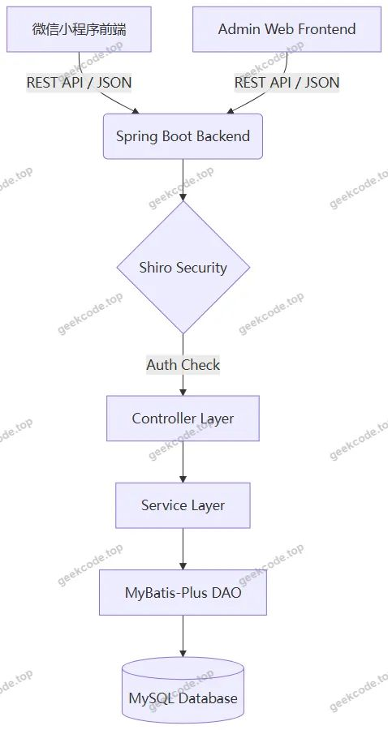
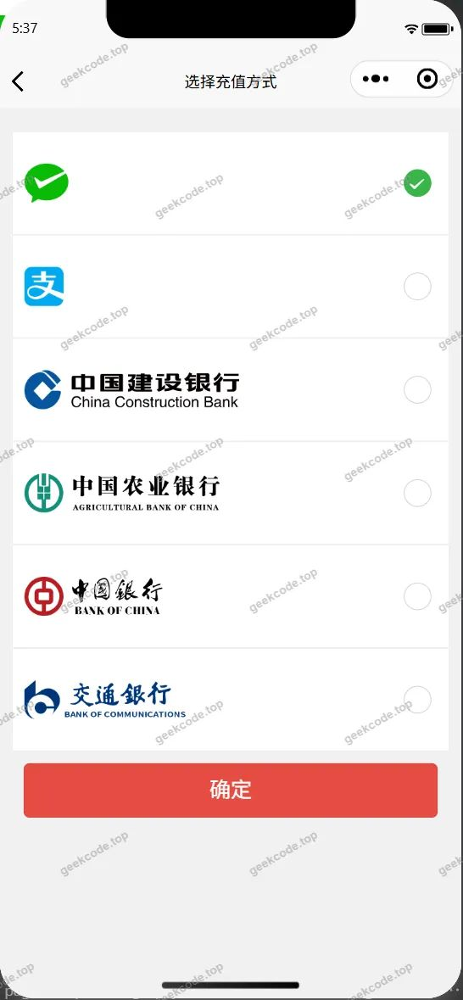
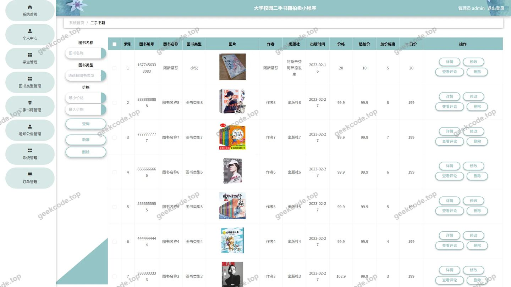
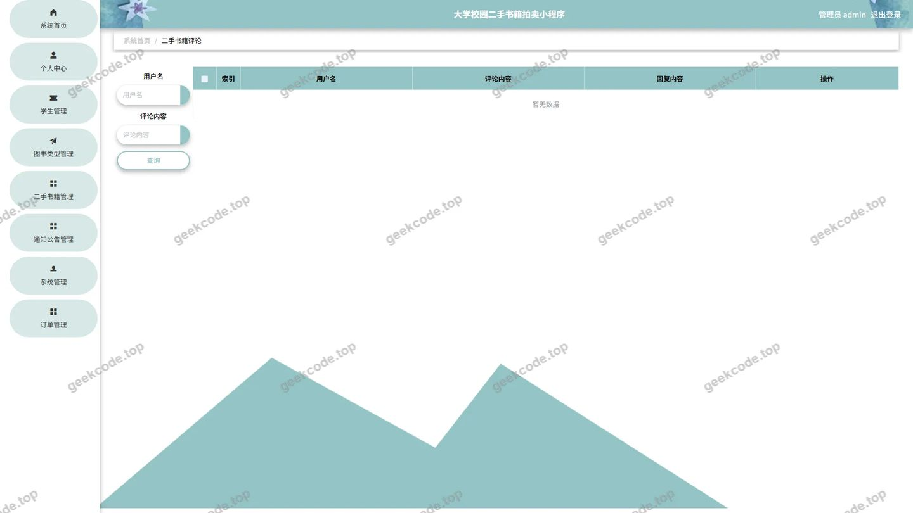
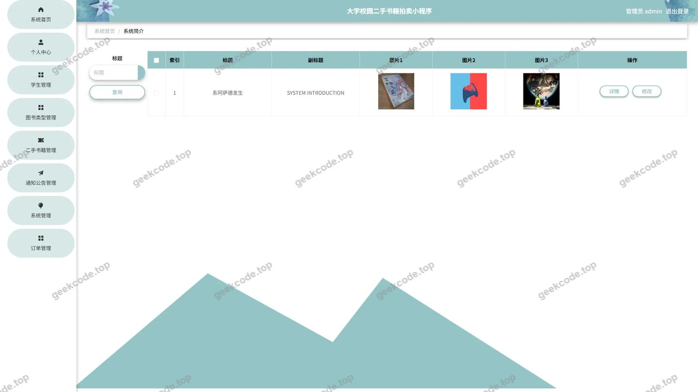
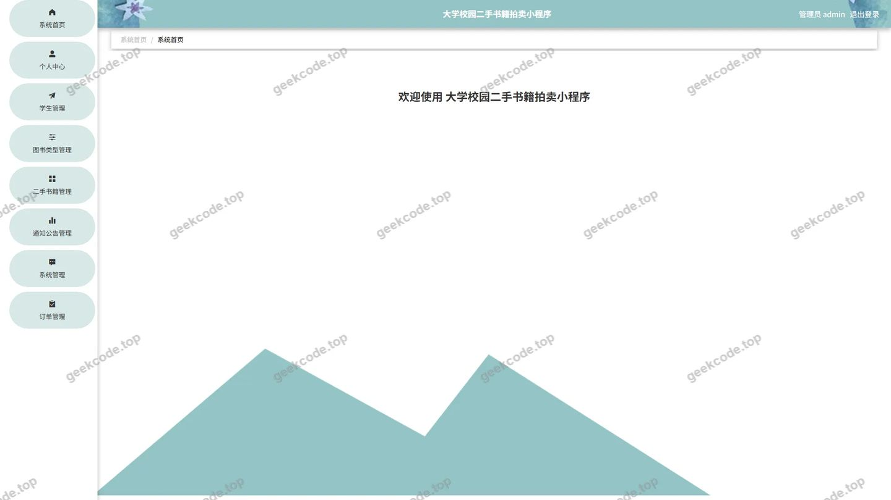
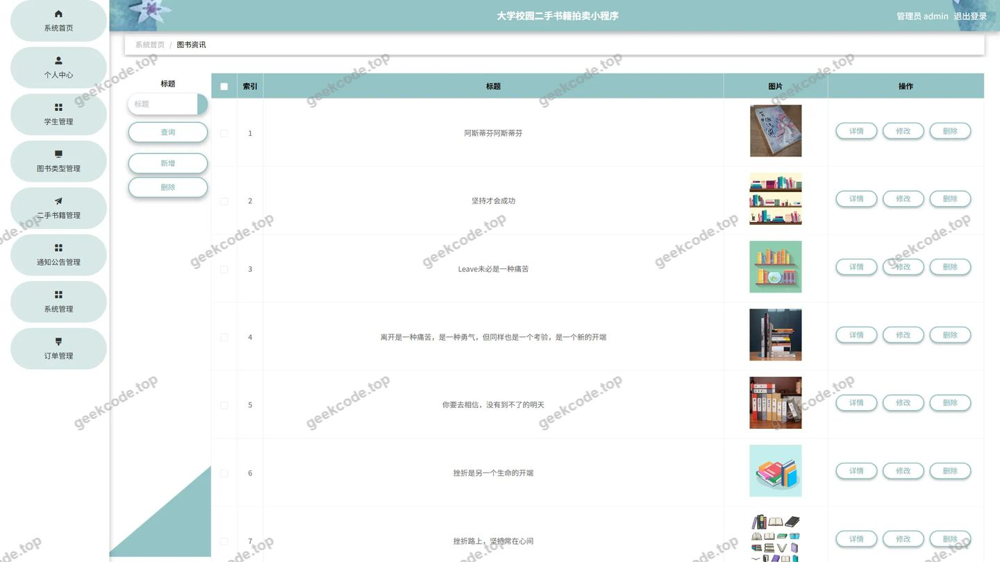
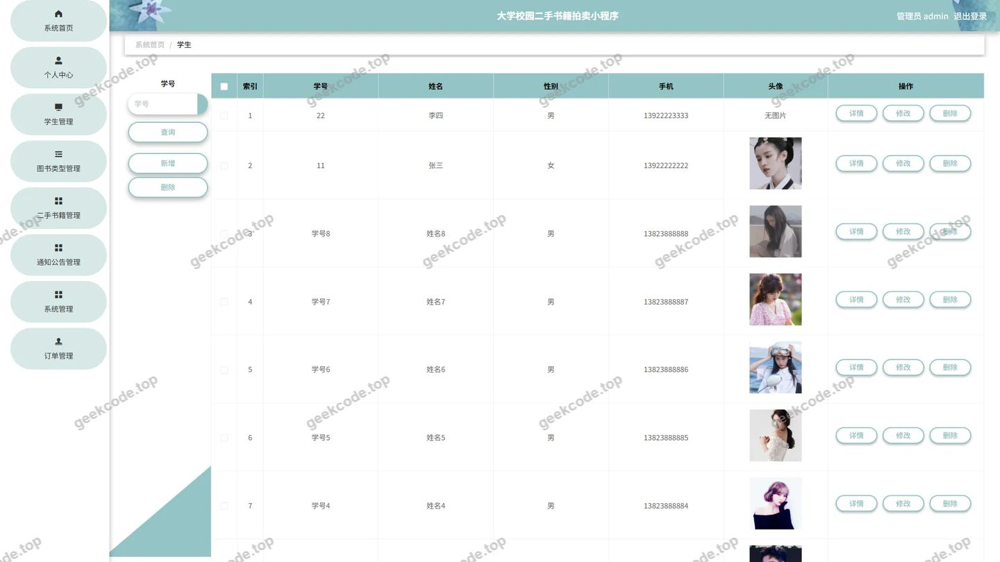

# 大学校园二手书籍拍卖小程序1505s

> 🎓 **计算机毕业设计 · 大学校园二手书籍拍卖小程序1505s**
>
> 本仓库只放**项目介绍 + 运行截图**（截图是站点带水印的原图，存在仓库 `images/` 里）。
>
> 👉 **完整可运行源码 / 数据库脚本 / 部署文档：[点我获取](https://geekcode.top/archives/%E5%A4%A7%E5%AD%A6%E6%A0%A1%E5%9B%AD%E4%BA%8C%E6%89%8B%E4%B9%A6%E7%B1%8D%E6%8B%8D%E5%8D%96%E5%B0%8F%E7%A8%8B%E5%BA%8F1505s?utm_source=github)**
>
> 💬 咨询微信：**ir9372**　|　🌐 更多项目：[极客代码 geekcode.top](https://geekcode.top/?utm_source=github)
>
> 📌 项目详情页：<https://geekcode.top/archives/%E5%A4%A7%E5%AD%A6%E6%A0%A1%E5%9B%AD%E4%BA%8C%E6%89%8B%E4%B9%A6%E7%B1%8D%E6%8B%8D%E5%8D%96%E5%B0%8F%E7%A8%8B%E5%BA%8F1505s?utm_source=github>

<table><td width="230" align="center"> <b>扫码加微信 ir9372</b></td><td valign="middle">📦 源码 = 项目介绍 + 全部运行截图 + 数据库 + 部署文档 👉 点上方任意截图，直接跳到 <b>极客代码 geekcode.top</b> 详情页</td></table>

---

<h1>大学校园二手书籍拍卖小程序_1505s</h1>
<h2>项目概述</h2>

本项目为“大学校园二手书籍拍卖小程序”，旨在解决高校师生间二手教材流转效率低、信息不对称及交易安全性不足的问题。系统采用微信小程序作为用户端，Java Spring Boot 构建后端服务，实现从书籍发布、在线竞拍、订单管理到物流追踪的全流程闭环。核心功能包括二手书籍展示与拍卖、图书资讯发布、在线客服沟通及后台统一管理。适用人群主要为在校大学生（买家/卖家）及学校管理员。技术架构上，前端通过 REST API 与后端交互，后端集成 MyBatis-Plus 进行数据持久化，使用 Shiro 保障权限安全，具备高并发处理能力和良好的用户体验。

<h2>技术架构</h2>
<h3>前后端分离架构</h3>

系统采用典型的前后端分离模式。

<ul>
<li><strong>前端</strong>：基于微信小程序原生框架或 Vue 语法糖构建，负责页面渲染、用户交互及状态管理。通过 <code>wx.request</code> 发起 HTTPS 请求，遵循 RESTful 规范与后端通信。</li>
<li><strong>后端</strong>：基于 Java Spring Boot 框架，提供统一的 API 接口服务。Controller 层接收请求，Service 层处理业务逻辑，DAO 层操作数据库。</li>
</ul>
<h3>核心技术选型</h3>
<ul>
<li><strong>Web 框架</strong>：Spring Boot，利用其自动配置和起步依赖特性，快速搭建微服务基础，简化部署流程。</li>
<li><strong>ORM 框架</strong>：MyBatis-Plus，在 MyBatis 基础上增强 CRUD 能力，减少 XML 配置，提高开发效率，支持复杂查询与分页。</li>
<li><strong>安全框架</strong>：Apache Shiro，用于身份认证（Authentication）和授权（Authorization），确保只有合法用户才能访问特定资源，保护数据安全。</li>
<li><strong>数据库连接</strong>：MySQL Connector/J，配合 Spring JDBC 实现高效的数据读写。</li>
</ul>
<h3>交互方式</h3>

小程序前端与 Java 后端通过 JSON 格式数据进行交互。后端 Controller 返回统一封装的响应对象（包含状态码、消息体、数据列表），前端解析后更新视图模型。所有敏感操作均经过 Token 验证，防止未授权访问。

<h2>功能模块</h2>

根据后台路由 <code>/ershoushuji</code>, <code>/news</code>, <code>/discussershoushuji</code>, <code>/systemintro</code>, <code>/xuesheng</code>, <code>/auctionershoushuji</code>, <code>/chat</code>, <code>/tongzhigonggao</code>, <code>/tushuleixing</code>, <code>/orders/:status</code>, <code>/storeup</code>, <code>/config</code> 及截图所示，系统分为小程序用户端和 Web 后台管理端两大模块。

<h3>1. 小程序用户端功能</h3>
<h4>首页与资讯浏览</h4>
<ul>
<li><strong>首页展示</strong>：推荐热门二手书籍、最新拍卖信息及系统公告。</li>
<li><strong>图书资讯</strong>：查看关于二手书交易指南、校园活动新闻等内容（对应 <code>/news</code>）。</li>
<li><strong>通知公告</strong>：接收平台发布的官方通知（对应 <code>/tongzhigonggao</code>）。</li>
</ul>
<h4>二手书籍交易核心</h4>
<ul>
<li><strong>书籍浏览与搜索</strong>：按分类查看在售或待拍卖的二手书籍详情（对应 <code>/ershoushuji</code>）。</li>
<li><strong>在线竞拍</strong>：参与书籍拍卖，实时出价，查看竞拍记录（对应 <code>/auctionershoushuji</code>）。</li>
<li><strong>评论互动</strong>：对已购或关注的书籍发表评论，与其他用户交流（对应 <code>/discussershoushuji</code>）。</li>
</ul>
<h4>个人中心与服务</h4>
<ul>
<li><strong>用户注册/登录</strong>：支持手机号或账号密码登录，完善个人信息。</li>
<li><strong>购物车</strong>：将心仪书籍加入购物车，支持批量结算。</li>
<li><strong>订单管理</strong>：查看“我的订单”，跟踪订单状态（待付款、已发货等），查看物流信息（对应 <code>/orders/:status</code>）。</li>
<li><strong>收货地址管理</strong>：新增、编辑、删除收货地址，设置默认地址。</li>
<li><strong>我的收藏</strong>：收藏感兴趣的书籍，便于后续查找（对应 <code>/storeup</code>）。</li>
<li><strong>账户充值</strong>：进行余额充值，用于支付拍卖保证金或购买书籍（对应截图“账户充值payconfirm”）。</li>
<li><strong>在线客服</strong>：通过聊天窗口联系管理员或客服，咨询交易问题（对应 <code>/chat</code>）。</li>
</ul>
<h4>简易管理入口（小程序内）</h4>
<ul>
<li>部分截图显示小程序内存在“管理端-学生列表”、“管理端-图书类型列表”、“管理端-系统简介列表”页面，表明管理员可能通过小程序移动端进行轻量级数据查看或维护。</li>
</ul>
<h3>2. Web 后台管理端功能</h3>

后台主要面向超级管理员，提供全面的数据管理和系统配置功能。

<ul>
<li><strong>系统登录</strong>：管理员账号密码登录，进入控制台。</li>
<li><strong>二手书籍管理</strong>：审核、上架、下架二手书籍信息，编辑书籍详情及图片。</li>
<li><strong>拍卖记录管理</strong>：查看所有用户的竞拍历史，监控异常竞价行为。</li>
<li><strong>图书资讯管理</strong>：发布、编辑、删除校园新闻和交易指南文章。</li>
<li><strong>评论管理</strong>：审核用户发表的书籍评论，删除违规内容。</li>
<li><strong>学生信息管理</strong>：查看注册用户（学生）资料，禁用违规账号，重置密码。</li>
<li><strong>在线客服管理</strong>：回复用户咨询，处理售后纠纷。</li>
<li><strong>通知公告管理</strong>：发布全站广播消息。</li>
<li><strong>图书类型管理</strong>：维护书籍分类标签（如教材、小说、考研资料等）。</li>
<li><strong>订单管理</strong>：处理全平台订单，确认收款，填写物流单号，处理退款申请。</li>
<li><strong>收藏管理</strong>：查看用户收藏数据，分析热门书籍趋势。</li>
<li><strong>系统配置</strong>：修改网站基本信息、关于我们介绍（对应 <code>/systemintro</code>）、轮播图配置等。</li>
</ul>
<h2>用户角色与权限</h2>

系统主要涉及两类角色：<strong>普通用户（学生）</strong> 和 <strong>管理员</strong>。

<h3>1. 普通用户（学生）</h3>
<ul>
<li><strong>权限范围</strong>：仅限小程序端。</li>
<li><strong>功能权限</strong>：</li>
<li>浏览公开信息（书籍、资讯、公告）。</li>
<li>执行个人交易操作（注册、登录、发布求购意向、参与竞拍、下单、支付、评价）。</li>
<li>管理个人数据（修改头像/昵称、管理收货地址、查看订单、管理收藏）。</li>
<li>发起客服咨询。</li>
<li><strong>限制</strong>：无法访问后台管理系统，无法修改其他用户数据，无法发布官方资讯。</li>
</ul>
<h3>2. 管理员</h3>
<ul>
<li><strong>权限范围</strong>：Web 后台管理系统 + 小程序内的特定管理页面（视具体实现而定，通常以 Web 为主）。</li>
<li><strong>功能权限</strong>：</li>
<li><strong>全局数据掌控</strong>：对所有书籍、订单、用户、评论拥有增删改查权限。</li>
<li><strong>内容运营</strong>：发布新闻、公告，维护图书分类。</li>
<li><strong>风控与安全</strong>：审核竞拍记录，封禁恶意用户，处理投诉。</li>
<li><strong>系统维护</strong>：配置系统参数，查看数据统计报表。</li>
<li><strong>限制</strong>：通常不参与具体的书籍买卖竞拍业务逻辑（除非模拟测试），主要职责是监管和服务。</li>
</ul>
<h2>项目特色与创新点</h2>
<ol>
<li><strong>“拍卖+电商”混合模式</strong>：不同于传统的固定价格二手交易平台，本项目引入了“在线竞拍”机制（<code>AuctionershoushujiController</code>），增加了交易的趣味性和稀缺书籍的价值发现能力，更贴合校园中绝版教材或签名书的交易场景。</li>
<li><strong>即时通讯集成</strong>：内置在线客服模块（<code>ChatController</code>），实现了买卖双方或用户与平台间的实时沟通，降低了交易信任成本，提升了售后响应速度。</li>
<li><strong>轻量化移动管理</strong>：在小程序端也提供了部分管理视图（如学生列表、图书类型），使得管理员可以在移动端随时监控关键数据，提高了管理的灵活性和及时性。</li>
<li><strong>完整的交易闭环</strong>：涵盖了从“看（资讯/书籍）-&gt; 聊（客服/评论）-&gt; 买（竞拍/购物车）-&gt; 付（充值/订单）-&gt; 收（物流/地址）”的全生命周期，数据结构严谨，业务流程清晰。</li>
</ol>
<h2>部署环境</h2>

为确保项目正常运行，需准备以下软硬件环境：

<h3>1. 后端运行环境</h3>
<ul>
<li><strong>操作系统</strong>：Windows 10/11, Linux (CentOS/Ubuntu), macOS。</li>
<li><strong>JDK 版本</strong>：Java Development Kit 1.8 或以上（推荐 JDK 1.8，兼容性好）。</li>
<li><strong>Maven</strong>：3.6.0 或以上，用于依赖管理和项目构建。</li>
<li><strong>数据库</strong>：MySQL 5.7 或 MySQL 8.0，需导入项目提供的 SQL 脚本初始化表结构。</li>
<li><strong>IDE</strong>：IntelliJ IDEA 或 Eclipse，用于代码开发和调试。</li>
</ul>
<h3>2. 前端运行环境</h3>
<ul>
<li><strong>微信开发者工具</strong>：最新版本，用于编译、预览和上传微信小程序代码。</li>
<li><strong>Node.js</strong>：若前端工程基于 Vue CLI 构建，需安装 Node.js (LTS 版本) 和 npm/yarn，用于安装前端依赖包。</li>
</ul>
<h3>3. 网络环境</h3>
<ul>
<li>后端服务器需开放指定端口（默认为 8080 或配置文件中指定的端口），并确保防火墙允许外部访问。</li>
<li>微信小程序需在真机或模拟器上运行，要求设备连接互联网，且后端 API 地址需配置为合法的 HTTPS 域名（生产环境）或在开发者工具中开启“不校验合法域名”选项（开发环境）。</li>
</ul>
<h2>五、技术特性</h2>
<ul>
<li>前后端集成部署，前端资源打包至后端 static 目录</li>
<li>使用 MyBatis-Plus 简化数据访问层开发</li>
<li>集成 Shiro 权限框架实现角色权限控制</li>
</ul>
<h2>六、功能模块截图</h2>
<h3>微信小程序用户端</h3>

<figure><figcaption>小程序-登录</figcaption></figure>
<figure><figcaption>小程序-二手书籍</figcaption></figure>
<figure><figcaption>小程序-个人信息</figcaption></figure>
<figure><figcaption>小程序-购物车</figcaption></figure>
<figure><figcaption>小程序-确认订单</figcaption></figure>
<figure><figcaption>小程序-收货地址</figcaption></figure>
<figure><figcaption>小程序-收货地址详情</figcaption></figure>
<figure><figcaption>小程序-首页</figcaption></figure>
<figure><figcaption>小程序-通知公告</figcaption></figure>
<figure><figcaption>小程序-图书资讯</figcaption></figure>
<figure><figcaption>小程序-我的</figcaption></figure>
<figure><figcaption>小程序-我的订单</figcaption></figure>
<figure><figcaption>小程序-我的订单logistics</figcaption></figure>
<figure><figcaption>小程序-我的收藏列表</figcaption></figure>
<figure><figcaption>小程序-在线客服</figcaption></figure>
<figure><figcaption>小程序-账户充值payconfirm</figcaption></figure>
<figure><figcaption>小程序-注册</figcaption></figure>

<h3>微信小程序管理端</h3>

<figure><figcaption>小程序-管理端-图书类型列表</figcaption></figure>
<figure><figcaption>小程序-管理端-系统简介列表</figcaption></figure>
<figure><figcaption>小程序-管理端-学生列表</figcaption></figure>

<h3>后台管理端</h3>
<h4>后台-登录页</h4>

<h4>后台-二手书籍</h4>

<h4>后台-二手书籍竞拍记录</h4>

<h4>后台-二手书籍评论</h4>

<h4>后台-关于我们</h4>

<h4>后台首页</h4>

<h4>后台-图书资讯</h4>

<h4>后台-学生</h4>

---

## 获取完整源码

| 项目 | 说明 |
| --- | --- |
| 项目名 | 大学校园二手书籍拍卖小程序1505s |
| 运行截图 | 本文 29 张（站点带水印原图，仓库 `images/` 目录） |
| 完整源码 | [https://geekcode.top/archives/%E5%A4%A7%E5%AD%A6%E6%A0%A1%E5%9B%AD%E4%BA%8C%E6%89%8B%E4%B9%A6%E7%B1%8D%E6%8B%8D%E5%8D%96%E5%B0%8F%E7%A8%8B%E5%BA%8F1505s?utm_source=github](https://geekcode.top/archives/%E5%A4%A7%E5%AD%A6%E6%A0%A1%E5%9B%AD%E4%BA%8C%E6%89%8B%E4%B9%A6%E7%B1%8D%E6%8B%8D%E5%8D%96%E5%B0%8F%E7%A8%8B%E5%BA%8F1505s?utm_source=github) |
| 咨询微信 | **ir9372**（备注：jingpin-yuanma） |
| 更多项目 | [极客代码 geekcode.top](https://geekcode.top/?utm_source=github) |

> 需要源码、部署、改配置、跑不起来等问题，加微信 ir9372 沟通，说明项目名即可。
